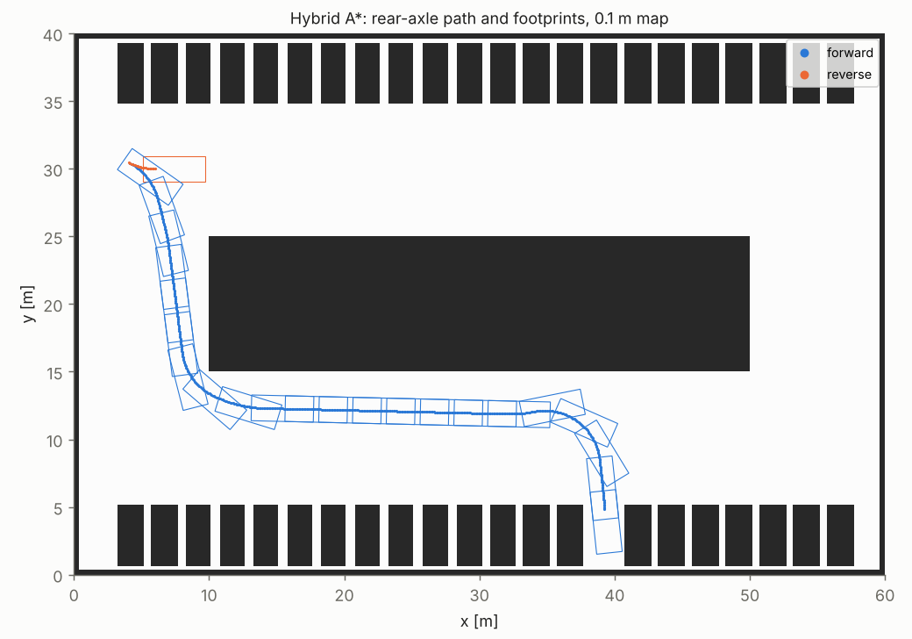
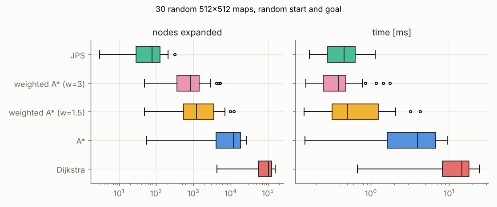
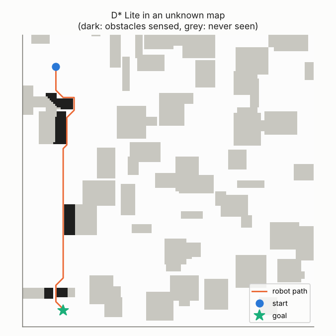
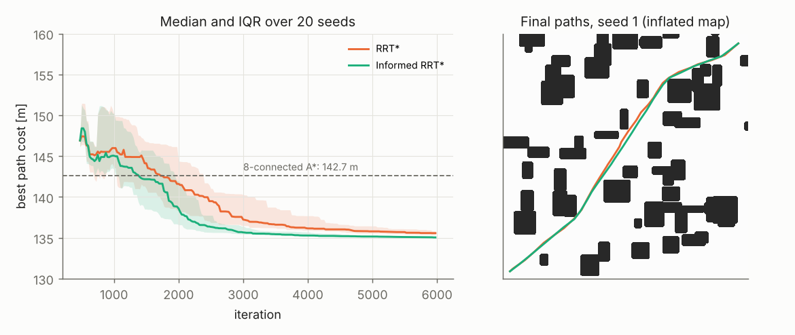
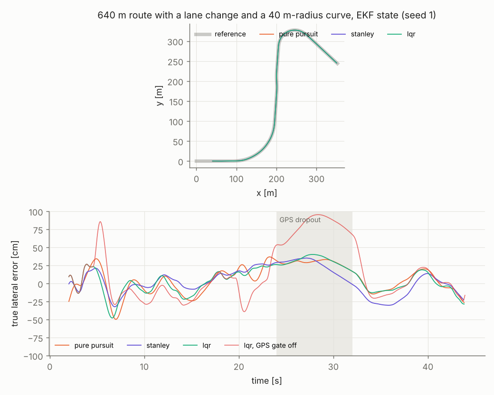
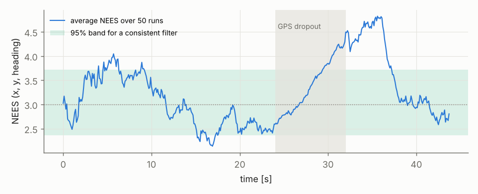

# Planner Gauntlet: Search, Replanning, Kinodynamic Planning and Tracking in C++

A C++ planning stack for ground vehicles, built so every algorithm is checked against a reference instead of eyeballed. It covers optimal grid search (Dijkstra, A*, weighted A*, Jump Point Search), incremental replanning in unknown maps (D* Lite), kinodynamic planning for a car (Hybrid A* with a Dubins analytic expansion), sampling-based planning (RRT* and Informed RRT*), and the part that usually gets skipped, which is following the plan from a noisy state estimate (an EKF fusing gyro, wheel speed and GPS, feeding Pure Pursuit, Stanley and LQR trackers).

Correctness is enforced by property tests. Every optimal planner must return the Dijkstra cost on hundreds of random maps, every path must be a legal move sequence whose length equals the reported cost, weighted A* must stay inside its bound, and D* Lite must agree with A* from scratch after every single replan.



## How to run

```bash
./scripts/run_all.sh                     # build, 14 test suites, experiments, Google Benchmark, plots (~1 min)
docker build -t planner-gauntlet . && docker run --rm planner-gauntlet
./build/pg_experiments hybrid --out results
```

## Results

### Optimal grid search

8-connected grid, no corner cutting (a diagonal move needs both orthogonal cells free, otherwise a robot of non-zero size clips the corner). Random rectangle maps with random start and goal.

| 512x512 maps (28 queries) | Median expansions | Median time | Mean cost / optimal | Worst cost / optimal |
|---|---|---|---|---|
| Dijkstra | 103,000 | 14.6 ms | 1 | 1 |
| A* (octile) | 11,900 | 3.95 ms | 1 | 1 |
| Weighted A*, w = 1.5 | 1,210 | 0.50 ms | 1.03 | 1.08 |
| Weighted A*, w = 3 | 845 | 0.38 ms | 1.06 | 1.19 |
| Jump Point Search | 77 | 0.46 ms | 1 | 1 |



On one corner-to-corner 1024x1024 query (Google Benchmark), JPS took 5.1 ms against 77.7 ms for A* and 51.6 ms for Dijkstra. On that map A* expanded 41 % fewer nodes than Dijkstra and still ran slower. The octile heuristic pulled it into dead-end pockets, its open list grew larger, and heap operations cost more per expansion. Expansion counts are a proxy for runtime, not a measurement of it.

Across the 58 experiment queries and the 300-map property test, A* and JPS matched the Dijkstra cost to 1e-9 every time, and weighted A* never exceeded $w$ times optimal.

### D* Lite in unknown maps

The robot starts knowing only the map border, senses a 6-cell disc each step, and replans whenever its belief changes. D* Lite repairs its search tree. The baseline reruns A* from the robot's cell on the same belief.

| Map side | Replans | D* Lite expansions | A* expansions | D* Lite time | A* time | Cost mismatches |
|---|---|---|---|---|---|---|
| 160 | 825 | 47,700 | 67,700 | 36 ms | 20 ms | 0 |
| 400 | 2,038 | 189,000 | 1,730,000 | 156 ms | 529 ms | 0 |



On large maps D* Lite expanded 9.1x fewer vertices and ran 3.4x faster. On small maps it expanded 1.4x fewer and ran 1.9x slower, because each D* Lite expansion recomputes $rhs$ over 8 neighbours and its queue carries stale entries. Incremental search pays off when a from-scratch search is expensive, and a 160x160 map is not.

### Hybrid A* parking

A 4.6 m by 1.9 m car (2.8 m wheelbase, 0.6 rad steering, 4.1 m turning radius) parks nose-in from the far aisle of a 60 m by 40 m lot mapped at 0.1 m. The footprint is five discs checked against a Euclidean distance transform (Felzenszwalb-Huttenlocher, 5.9 ms for 512x512). The state lattice is 0.5 m by 5°, with forward and reverse arcs at five steering angles and penalties on reversing, direction switches and steering changes.

| Variant | Expansions | Time | Path length | Direction switches |
|---|---|---|---|---|
| Full (holonomic + Dubins heuristics, analytic expansion) | 14,500 | 200 ms | 55.4 m | 1 |
| Without the Dubins heuristic | 13,100 | 207 ms | 56.8 m | 1 |
| Without the obstacle-aware holonomic heuristic | 40,600 | 505 ms | 55.8 m | 1 |
| Without analytic expansion | 184,000 | 1,655 ms | 74.0 m | 0 |
| Forward only | 20,800 | 154 ms | 75.2 m | 0 |

The analytic Dubins shot to the goal is the single biggest lever (12.7x fewer expansions). The holonomic heuristic, a Dijkstra distance field on the map inflated by half the car width, is next (2.8x). The Dubins heuristic did not help here. With reverse allowed it is not admissible, and the holonomic term already dominates in this lot.

### RRT* vs Informed RRT*

100 m by 100 m map, obstacles inflated by 0.5 m, start and goal in opposite corners, 20 seeds each.

| Iterations | RRT* median cost | Informed RRT* median cost |
|---|---|---|
| 1,000 | 146.0 m | 145.1 m |
| 2,000 | 141.6 m | 138.6 m |
| 4,000 | 136.2 m | 135.3 m |
| 6,000 | 135.6 m | 135.1 m |



Both beat the 8-connected A* path (142.7 m) because they are not restricted to 45° headings. Informed sampling only starts helping once a first solution exists (median iteration 749 for both, since they share seeds), and its advantage is largest in the middle of the run. With start and goal 131 m apart and a first solution near 146 m, the informed ellipse still covers a large part of the map, which caps the gain.

### Tracking with an estimated state

A 4 m-wheelbase vehicle with a 0.2 s steering lag and 0.6 rad/s steering rate limit drives a 640 m route (a 100 m-radius curve, a 3.7 m lane change, a 40 m-radius curve) at up to 20 m/s, with speed limited to 2 m/s² lateral acceleration. The EKF state is position, heading, speed and gyro bias. Gyro and wheel speed arrive at 100 Hz and GPS at 10 Hz with 0.5 m noise, 2 % multipath jumps of 8 m, and an 8 s dropout. Twenty seeds per cell.

| Tracker | State source | RMS lateral | Max lateral | RMS heading |
|---|---|---|---|---|
| LQR | true state | 1.5 cm | 4.2 cm | 0.13° |
| Pure Pursuit | true state | 3.5 cm | 14.9 cm | 0.23° |
| Stanley | true state | 9.5 cm | 19.8 cm | 0.17° |
| LQR | EKF, gated | 17.0 cm | 49.4 cm | 0.62° |
| Pure Pursuit | EKF, gated | 18.7 cm | 54.5 cm | 0.63° |
| Stanley | EKF, gated | 18.4 cm | 45.0 cm | 0.47° |
| LQR | EKF, no gate | 79.0 cm | 190 cm | 4.74° |
| Pure Pursuit | EKF, no gate | 32.5 cm | 101 cm | 1.11° |
| Stanley | EKF, no gate | 31.2 cm | 86.8 cm | 0.84° |



With the true state the LQR (lateral error, heading error and steering angle as states, the actuator lag in the model, curvature feedforward, gains re-solved per 0.5 m/s speed bin) is 2.3x better than Pure Pursuit and 6.4x better than Stanley. With the estimate, all three land within 2 cm of each other because the estimator's 16.9 cm position error sets the floor. Without the χ² gate on GPS innovations, the LQR became the worst of the three by a wide margin. The gain that makes it the best tracker also makes it follow every 8 m GPS jump hardest.

Filter consistency over 50 Monte Carlo runs. Mean NIS over 17,912 accepted fixes was 1.98 against 2.00 expected.

| Phase | Mean NEES (3 dof) | Epochs inside the 95 % band |
|---|---|---|
| Before the dropout | 3.02 | 84 % |
| During the dropout | 3.38 | 68 % |
| 8 s after GPS returns | 4.01 | 34 % |
| Rest of the run | 2.88 | 100 % |



The filter is consistent in steady state and overconfident right after GPS comes back. After 8 s of dead reckoning the first fixes produce large corrections, and the EKF's linearization at the drifted estimate underestimates the resulting covariance. An iterated or invariant EKF, or inflating $Q$ during dropouts, are the standard fixes.

## What worked

Property-based tests caught every real bug in this repo. JPS, A* and weighted A* on 300 random maps, D* Lite against A* after every replan, Dubins endpoints and curvature bounds on 2,000 random queries, and Hybrid A* footprint checks along every path sample.

Hybrid A* with the analytic expansion solved the parking problem in 200 ms. The stitched path is continuous to 0.1 m and every sample passes the footprint check.

The χ² gate rejected 7.95 fixes per run when 7.7 multipath jumps were injected, so it caught the outliers while discarding well under 0.1 % of good fixes, which is what a 99.9 % threshold should do.

## What did not work

D* Lite initially disagreed with A* on 50 replans across 20 maps, always by reporting a cost that was too low. Two bugs were stacked. First I advanced the key modifier $k_m$ on every robot step. It must only advance by $h(s_{last}, s_{start})$ when the map changes, and summing per-step heuristics overestimates it by the triangle inequality. Fixing that changed nothing, which led to the real cause. On a grid with √2 edges, $g + h$ for two vertices on the same optimal path agreed only to 1e-15, the exact key comparison broke the tie the wrong way, and the search stopped one expansion early with the start's $g$ still stale. A tolerant comparison (1e-9) fixed all of them. A 30x30 minimal reproduction with printed $g$/$rhs$ around the start found it in three iterations.

The first benchmark run reported identical expansion counts for Dijkstra, A* and weighted A* on the 1024 map. The goal was unreachable and all three were exhausting the reachable region. The benchmark now refuses to run unless the query is solvable.

My first "no analytic expansion" ablation still finished with a Dubins shot, because the shot was also triggered within 10 m of the goal regardless of the setting. The ablation numbers above come from the corrected toggle.

The Dubins heuristic, which I expected to help in the parking lot, slightly hurt. With reverse allowed it is inadmissible, and here the obstacle-aware holonomic distance was always the larger term anyway.

The NEES test failed after GPS reacquisition (34 % of epochs in band). I left it failing and documented it, because a consistency test that is tuned until it passes is not a test.

## Tools and techniques applied

Planning used Dijkstra, A*, weighted A*, Jump Point Search, heuristic admissibility and consistency, D* Lite (LPA*-style incremental repair), Hybrid A* on a state lattice with motion primitives, Dubins curves (all six words), obstacle-aware heuristics, analytic expansion, RRT* with rewiring and subtree cost propagation, Informed RRT* with prolate-ellipsoid sampling, Euclidean distance transforms, and costmap inflation.

Estimation and control used an extended Kalman filter with Joseph-form updates, multi-rate sensor fusion, χ² innovation gating for outlier rejection, NEES and NIS consistency testing, a kinematic bicycle model with actuator lag and rate limits, Pure Pursuit, Stanley, discrete LQR with speed-scheduled gains and curvature feedforward, and lateral-acceleration speed profiling.

Software covers C++ with templates (a generic `astar<Graph, Heuristic>` that runs on any graph type, used for Dijkstra, A*, weighted A* and the Hybrid A* heuristic field), `std::unique_ptr` and an abstract tracker interface, Eigen, CMake, GoogleTest with property-based tests, Google Benchmark, AddressSanitizer and UBSan, Docker on Ubuntu 24.04, GitHub Actions, Git, and Python (NumPy, SciPy, pandas, Matplotlib).

## Topics from the list used here

- Classical search (4A): Dijkstra, A*, weighted A*, Jump Point Search, incremental search with D* Lite (LPA*-style repair), heuristic design with admissibility and consistency checks.
- Sampling-based motion planning (4B): configuration spaces, collision checking, RRT*, Informed RRT*, Hybrid A*, state-lattice planning with motion primitives, planning with nonholonomic constraints.
- Navigation and path following (4C): grid-based planning, costmap design, obstacle inflation and footprint checking, dynamic replanning, Pure Pursuit, Stanley.
- Optimal control (1C): discrete-time LQR with speed-scheduled gains and curvature feedforward.
- Estimation and sensor fusion (3A, 3B, 3C): EKF with Joseph-form updates, sensor fusion across update rates, outlier rejection with a χ² gate, statistical consistency testing (NEES and NIS), innovation analysis, wheel odometry and dead reckoning through a GPS dropout.
- Motion and trajectory generation (2D): retiming under a lateral-acceleration limit.
- Autonomous vehicles (13A): kinematic bicycle model with steering lag and rate limits, lateral control, path tracking.
- Software engineering (8): C++, Python, Git, CMake, Ubuntu, GoogleTest, property-based testing, Google Benchmark, AddressSanitizer and UBSan, CI, Docker, NumPy, SciPy, pandas, Matplotlib, algorithmic complexity measured against expansion counts.
- System identification and experiments (14): Monte Carlo simulation, ablation studies, benchmarking against baselines.
- RoboJackets software training slides: Ubuntu, Docker, Git, templates (`astar<Graph, Heuristic>`), namespaces, classes and abstract interfaces, `std::unique_ptr`.

## What I learned

Expansion counts and runtime disagree often enough that I report both. A* lost to Dijkstra on one map, and D* Lite lost to A* on small maps.

A floating-point tie can break an algorithm whose correctness proof assumes exact arithmetic. The bug did not show up in small hand-built cases and appeared immediately under randomized property testing.

The best tracker on perfect state can be the worst on a real estimate. Tracking performance has to be measured with the estimator in the loop, and the outlier gate mattered more than the choice of tracking law.

Hybrid A* performance is mostly in the heuristics and the analytic expansion, not in the search itself.

## Limitations

Everything is simulated. The vehicle is a kinematic bicycle with no tire slip, which is optimistic at 20 m/s on a 40 m-radius curve. GPS noise is white with no correlated multipath. Hybrid A* uses Dubins rather than Reeds-Shepp curves for the analytic expansion, so the final approach is always forward. RRT* uses a brute-force nearest-neighbour search that would need a k-d tree beyond about 10,000 nodes.

## Resume entry

**Planner Gauntlet: Motion Planning and Tracking Stack** | C++, Eigen, GoogleTest, Google Benchmark, Python, Docker

- Cut 1024x1024 grid search time from 77.7 ms (A*) to 5.1 ms by implementing Jump Point Search for an 8-connected no-corner-cutting graph in C++, verified cost-equal to Dijkstra on 358 random maps with property-based GoogleTest suites.
- Planned a 55 m nose-in parking maneuver for a 4.6 m car in 200 ms with Hybrid A*, using a Dubins analytic expansion that cut node expansions 12.7x, and fixed a floating-point key-tie bug in D* Lite, after which incremental replanning matched A* on 2,863 replans and ran 3.4x faster on 400x400 unknown maps.
- Held a simulated 4 m-wheelbase vehicle to 17 cm RMS lateral error over a 640 m route with GPS multipath and an 8 s dropout by fusing gyro, wheel speed and GPS in an EKF with χ² innovation gating (4.7x lower error than ungated), checked with NIS and NEES consistency tests, comparing LQR, Pure Pursuit and Stanley tracking.

## Repository layout

```
include/pg/   grid + distance transform, search (A*, JPS), D* Lite, Dubins, Hybrid A*, RRT*, tracking + EKF
src/          implementations
apps/         pg_experiments (all experiments), pg_bench (Google Benchmark)
tests/        property-based GoogleTest suites
scripts/      run_all.sh, plot.py
results/      CSVs, figures, summary.md, benchmark.txt
```
# Planner-Gauntlet

